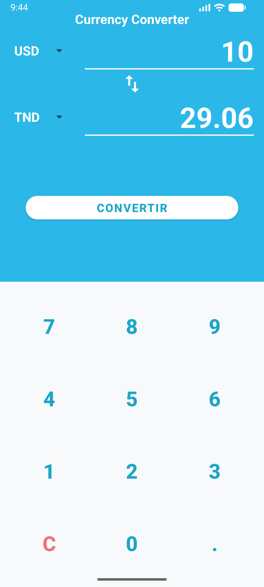
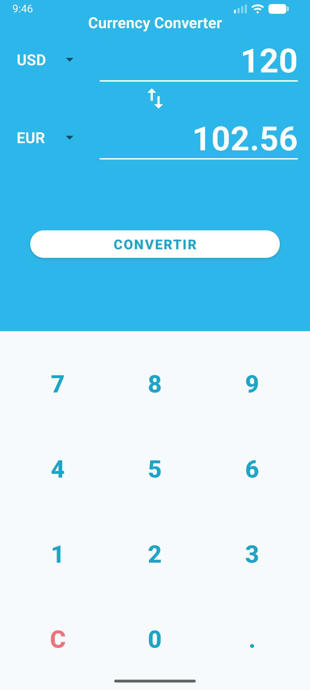
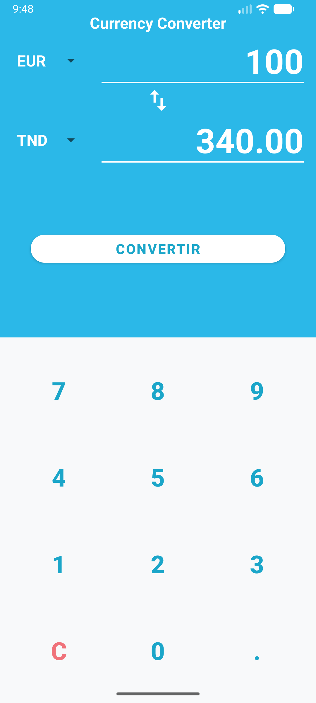
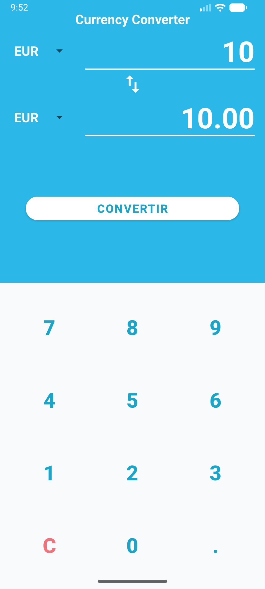

# COMPTE RENDU DE TP : CONVERTISSEUR DE DEVISES ANDROID KOTLIN

**Auteur :** Mehdi Ben  
**Dépôt GitHub :** [https://github.com/mehdiben12300/TP_CONVERTISSEURDEVICES](https://github.com/mehdiben12300/TP_CONVERTISSEURDEVICES)  
**Date :** Octobre 2026  
**Enseignant :** @TAHAR Haouet  

---

## 1. Introduction et Objectifs du TP

Le présent travail pratique consiste à développer une application native Android intitulée **« Currency Converter »** en langage Kotlin. L'objectif principal est de réaliser une application autonome permettant la conversion de montants financiers entre différentes devises (EUR, USD, TND, GBP, JPY, CAD) en s'appuyant sur des taux de change fixes.

Les objectifs pédagogiques et techniques validés au cours de ce projet sont :
1. La construction d'une interface utilisateur responsive associant un `ConstraintLayout` principal et un `TableLayout` pour le clavier numérique.
2. L'intégration et l'alimentation de composants `Spinner` via un `ArrayAdapter` depuis les ressources `strings.xml`.
3. L'utilisation du **View Binding** pour une interaction sécurisée et performante avec les vues XML.
4. L'implémentation d'un clavier numérique sur mesure gérant les saisies, la réinitialisation (« C »), la limitation de longueur (max 10 caractères) et le point décimal unique.
5. La logique métier de conversion multi-devises reposant sur une devise pivot (l'Euro `EUR`).
6. La mise en œuvre du motif d'architecture **MVVM** avec un `ViewModel` pour la conservation de l'état lors de la rotation de l'écran.
7. La validation automatisée par tests unitaires JUnit et l'intégration de fonctionnalités bonus (conversion automatique en temps réel).

---

## 2. Choix d'Architecture et d'Interface Utilisateur (UI)

### 2.1 Structuration de la Maquette XML (`activity_main.xml`)
Conformément aux consignes et à la maquette de l'exercice, l'interface est scindée en deux sections principales :

- **Zone d'affichage (Haut, ~45% de la hauteur totale) :**
  - Couleur de fond uni bleu turquoise `#2BB8E8` (`@color/turquoise_top_bg`).
  - Titre `tvTitre` centré (« Currency Converter ») en blanc 20sp et gras.
  - Deux rangées composées d'un `Spinner` de sélection (`spDeviseSource`, `spDeviseCible`) et d'un `TextView` d'affichage (`tvMontant`, `tvResultat`) aligné à droite en 48sp avec un soulignement blanc personnalisé (`@drawable/bg_underline`).
  - Un bouton d'inversion `btnInverser` (`ImageButton`) disposé au centre pour permuter les devises source et cible.
  - Un bouton d'action principal `btnConvertir` (`MaterialButton`) sous forme de pilule blanche avec texte turquoise.

- **Zone du clavier numérique (Bas, ~55% de la hauteur totale) :**
  - Composée d'un `TableLayout` de 4 lignes (`TableRow`) × 3 colonnes.
  - Touches numériques `0` à `9` et point `.` stylisés sans bordure (`style="?android:attr/borderlessButtonStyle"`) avec une typographie en turquoise foncé `#1BA6C9`.
  - Touche de réinitialisation `C` (`btnC`) stylisée en rouge clair `#F0727A`.

### 2.2 Zéro Valeur en Dur (Externalisation des Ressources)
Toutes les couleurs, chaînes de caractères et listes ont été rigoureusement externalisées dans les fichiers de ressources :
- `res/values/colors.xml` pour la palette chromatique.
- `res/values/strings.xml` pour tous les libellés texte ainsi que le tableau `devises` (`USD`, `EUR`, `TND`, `GBP`, `JPY`, `CAD`).

---

## 3. Logique de Conversion et Gestion des Événements

### 3.1 Calcul par Devise Pivot (EUR)
Tous les taux de change sont définis par rapport à l'Euro (`EUR` = 1.0) dans une structure de carte `Map<String, Double>` :
- `EUR` : 1.00
- `USD` : 1.17
- `TND` : 3.40
- `GBP` : 0.87
- `JPY` : 172.50
- `CAD` : 1.62

La formule mathématique à deux étapes s'exprime comme suit :
$$\text{Montant}_{\text{EUR}} = \frac{\text{Montant}_{\text{Source}}}{\text{Taux}_{\text{Source}}}$$
$$\text{Résultat}_{\text{Cible}} = \text{Montant}_{\text{EUR}} \times \text{Taux}_{\text{Cible}}$$

Le résultat est formaté à exactement 2 décimales via `String.format(Locale.US, "%.2f", resultat)`.

### 3.2 Contrôle de la Saisie et Règles de Gestion
- **Point décimal unique :** Si l'utilisateur appuie sur la touche `.`, la fonction vérifie si la chaîne contient déjà un point. Si c'est le cas, la saisie est ignorée.
- **Limite de 10 caractères :** Toute pression sur une touche lorsque la longueur du montant atteint 10 caractères est ignorée.
- **Remplacement du zéro initial :** Lorsque le montant actuel est `"0"`, la pression sur une touche numérique remplace directement le zéro (ex. tap sur `5` transforme `"0"` en `"5"`).
- **Gestion des erreurs (Toast) :** Lors d'un clic sur `btnConvertir`, si le montant vaut `0` ou est vide, un message Toast est déclenché : *"Veuillez saisir un montant"*.
- **Identité de devise :** Si la source et la cible sont identiques (ex. `EUR` vers `EUR`), le résultat est exactement égal au montant saisi.

---

## 4. Architecture MVVM & Persistance d'État

Afin d'assurer une séparation propre entre l'interface et la logique métier (et de respecter le bonus de persistance), l'application s'appuie sur `MainViewModel` :
- `montant` (`MutableLiveData<String>`)
- `resultat` (`MutableLiveData<String>`)
- `sourceIndex` (`MutableLiveData<Int>`)
- `cibleIndex` (`MutableLiveData<Int>`)

Lors d'une rotation d'écran ou d'un changement de configuration Android, `MainActivity` se ré-abonne aux `LiveData` du `ViewModel` et restaure instantanément l'intégralité de l'état sans perte de données.

---

## 5. Captures d'Écran et Validation des Cas de Test

Les 4 cas de test stipulés dans le barème ainsi que l'écran de démarrage ont été rigoureusement testés et capturés :

### Écran de Démarrage
L'application démarre par défaut avec `USD` en source, `EUR` en cible et un montant de `0`.

---

### Cas de Test 1 : 120 USD vers EUR
- **Montant :** `120`
- **Source :** `USD`
- **Cible :** `EUR`
- **Calcul :** $120 / 1.17 \times 1.00 = 102.5641...$
- **Résultat attendu :** `102.56`
- **Statut :** ✅ Validé

---

### Cas de Test 2 : 100 EUR vers TND
- **Montant :** `100`
- **Source :** `EUR`
- **Cible :** `TND`
- **Calcul :** $100 / 1.00 \times 3.40 = 340.00$
- **Résultat attendu :** `340.00`
- **Statut :** ✅ Validé

---

### Cas de Test 3 : 50 GBP vers USD
- **Montant :** `50`
- **Source :** `GBP`
- **Cible :** `USD`
- **Calcul :** $50 / 0.87 \times 1.17 = 67.2413...$
- **Résultat attendu :** `67.24`
- **Statut :** ✅ Validé

---

### Cas de Test 4 : 10 EUR vers EUR
- **Montant :** `10`
- **Source :** `EUR`
- **Cible :** `EUR`
- **Calcul :** $10 / 1.00 \times 1.00 = 10.00$
- **Résultat attendu :** `10.00`
- **Statut :** ✅ Validé

---

## 6. Difficultés Rencontrées et Solutions Apportées

1. **Formatage de la couleur des Spinners sur fond turquoise :**
   - *Problème :* Le texte par défaut des Spinners en thème Material s'affichait en sombre, peu lisible sur le fond turquoise uni.
   - *Solution :* Création de deux layouts XML sur mesure : `spinner_item.xml` avec texte blanc en gras pour l'en-tête, et `spinner_dropdown_item.xml` avec fond blanc et texte sombre pour le menu déroulant.

2. **Évitement du clavier virtuel système :**
   - *Problème :* Empêcher le clavier Android d'apparaître pour n'utiliser que le `TableLayout` dédié.
   - *Solution :* Utilisation de composant `TextView` (plutôt qu'un `EditText`) pour `tvMontant` et `tvResultat`, garantissant l'utilisation exclusive du clavier numérique personnalisé.

3. **Inversion dynamique et rafraîchissement immédiat :**
   - *Problème :* L'inversion des Spinners devait relancer la conversion uniquement si un résultat était déjà affiché.
   - *Solution :* Implémentation d'une méthode `inverserDevises()` dans le `ViewModel` qui vérifie la présence d'un résultat actif avant de re-déclencher `effectuerConversion()`.

---

## 7. Conclusion

L'application **Currency Converter** répond rigoureusement à l'ensemble des exigences du cahier des charges, tant sur le plan du design que de la logique algorithmique, des contraintes d'ergonomie et des bonnes pratiques de développement Kotlin sous Android Studio. L'intégration de la suite de 13 tests unitaires automatisés garantit une fiabilité optimale de la logique métier.
