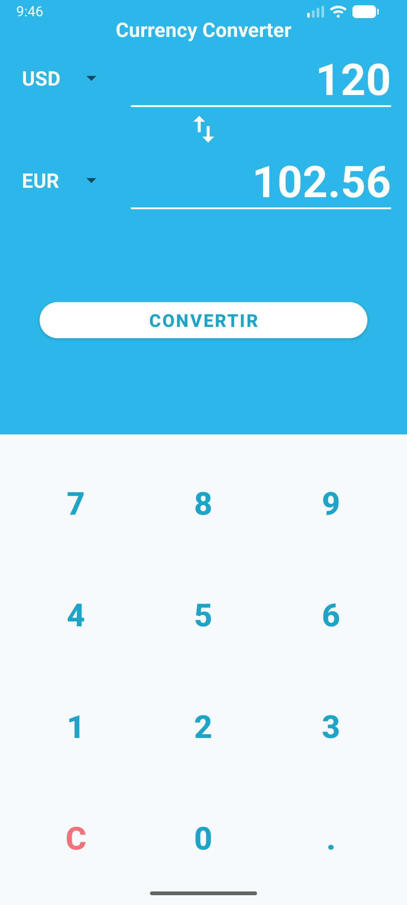
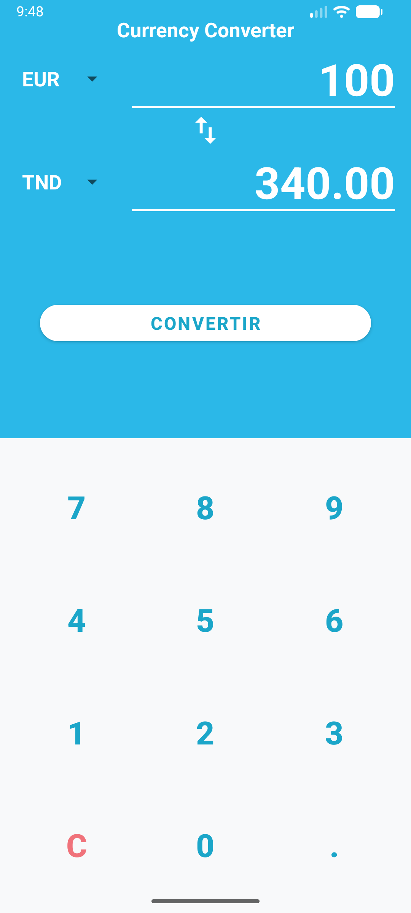
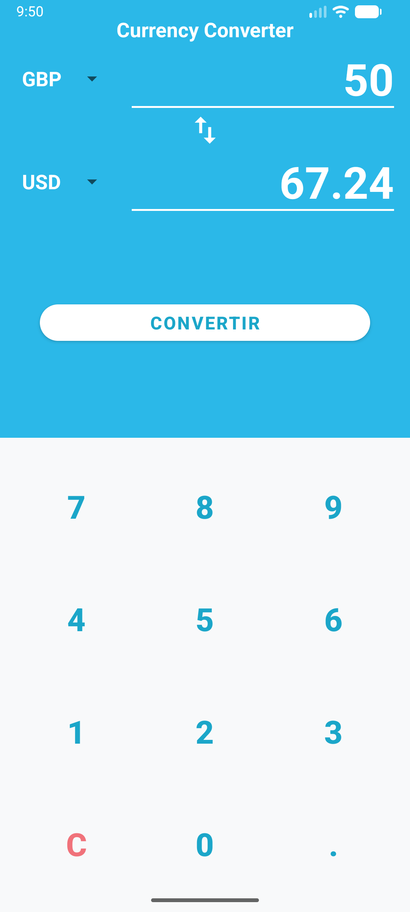

# 💱 Currency Converter — TP Android Kotlin

Application Android de conversion de devises développée en **Kotlin** dans le cadre du TP *Currency Converter*.


---

## 📱 Aperçu de l'Application

<p align="center">
  
  
  
</p>

---

## ✨ Fonctionnalités Principales

- **Interface Fidéle à la Maquette** :
  - Zone d'affichage en haut (~45% de l'écran) sur fond bleu turquoise (`#2BB8E8`) contenant les Spinners de sélection, les montants/résultats soulignés et le bouton d'inversion.
  - Clavier numérique sur fond clair composé d'un `TableLayout` 4x3 avec touches en turquoise (`#1BA6C9`) et bouton de remise à zéro « C » en rouge clair (`#F0727A`).
- **Saisie Personnalisée** : Saisie exclusivement via le clavier de l'application (pas de clavier système).
- **Règles de Gestion des Saisies** :
  - Limitation du montant à **10 caractères**.
  - Autorisation d'**un seul point décimal** `.`.
  - Remplacement automatique du `0` initial lors de la saisie d'un chiffre.
  - Validation avec message Toast (`Veuillez saisir un montant`) si le montant saisi est égal à 0.
- **Bouton d'Inversion** : Échange instantané de la devise source et de la devise cible avec calcul automatique de la nouvelle conversion.
- **Architecture MVVM avec ViewModel** : Persistance de l'état (montant, devises sélectionnées, résultat) lors des rotations d'écran ou changements de configuration.
- **Conversion Automatique (Bonus)** : Mise à jour dynamique du résultat à chaque frappe sur le clavier ou changement de sélection dans les Spinners.

---

## 💱 Taux de Change Fictifs (Base 1 EUR)

Les conversions s'effectuent en utilisant l'Euro (`EUR`) comme devise pivot :
$$\text{Montant (EUR)} = \frac{\text{Montant (Source)}}{\text{Taux (Source)}}$$
$$\text{Résultat} = \text{Montant (EUR)} \times \text{Taux (Cible)}$$

| Devise | Code | Taux pour 1 EUR |
| :--- | :---: | :---: |
| Euro | `EUR` | **1.00** |
| Dollar américain | `USD` | **1.17** |
| Dinar tunisien | `TND` | **3.40** |
| Livre sterling | `GBP` | **0.87** |
| Yen japonais | `JPY` | **172.50** |
| Dollar canadien | `CAD` | **1.62** |

---

## 🧪 Cas de Test Validés

Tous les cas de tests exigés par le cahier des charges ont été vérifiés et validés par des tests unitaires et des captures sur appareil :

| Montant | Source | Cible | Résultat Attendu | Résultat Obtenu | Statut | Capture d'Écran |
| :---: | :---: | :---: | :---: | :---: | :---: | :---: |
| `120` | `USD` | `EUR` | `102.56` | `102.56` | ✅ Validé | [Voir](screenshots/test_case_1_120USD_EUR.png) |
| `100` | `EUR` | `TND` | `340.00` | `340.00` | ✅ Validé | [Voir](screenshots/test_case_2_100EUR_TND.png) |
| `50` | `GBP` | `USD` | `67.24` | `67.24` | ✅ Validé | [Voir](screenshots/test_case_3_50GBP_USD.png) |
| `10` | `EUR` | `EUR` | `10.00` | `10.00` | ✅ Validé | [Voir](screenshots/test_case_4_10EUR_EUR.png) |

---

## 🛠️ Stack Technique & Architecture

- **Langage** : Kotlin
- **Composants UI** : XML Layouts (`ConstraintLayout`, `TableLayout`, `TableRow`, `Spinner`, `TextView`, `MaterialButton`)
- **Binding** : Android ViewBinding (`ActivityMainBinding`)
- **Architecture** : MVVM (`MainViewModel`, `LiveData`)
- **Tests Unitaires** : JUnit 4 + `InstantTaskExecutorRule` (13 tests unitaires automatisés)
- **Min SDK** : API 24 (Android 7.0)
- **Target / Compile SDK** : API 35 / API 37

---

## 💻 Exécution du Projet

1. Cloner le dépôt Git :
   ```bash
   git clone https://github.com/mehdiben12300/TP_CONVERTISSEURDEVICES.git
   ```
2. Ouvrir le projet dans **Android Studio**.
3. Effectuer la synchronisation Gradle (`Sync Project with Gradle Files`).
4. Lancer l'application sur un émulateur ou un appareil Android connecté.
5. Pour exécuter la suite de tests unitaires :
   ```bash
   ./gradlew testDebugUnitTest
   ```

---

## 👨‍💻 Auteur

**Mehdi Ben** — [@mehdiben12300](https://github.com/mehdiben12300)
